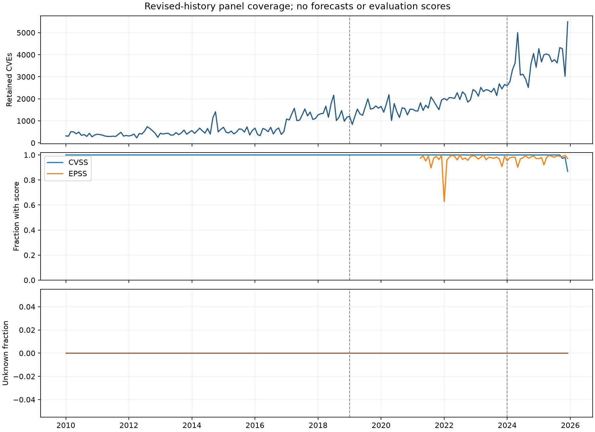

# Stage 5: monthly panel construction and validation

Completed 2026-10-20 for the primary revised-history count benchmark. Auxiliary
targets and their masks are constructed; the SEC likelihood remains ineligible.
No forecast model, held-out score, or monetary calibration was run.

## Frozen artifacts and reproducibility

Source: the unchanged `stage4-20261020` snapshot. Panel: `stage5-20261020`.
The [panel manifest](panels/stage5-20261020/panel_manifest.json) records clean
implementation commit `f19da703dad6592947ee39268249dd7270780fbc`, source-manifest,
code, policy and dependency hashes, software versions, and every generated file.
The code was committed before the production build. This avoids the dirty-source
record noted in the Stage 4 review. The later report commit contains the resulting
audit artifacts; it is not represented as the source revision that ran the build.

The five Stage 2 design files and original Stage 4 dictionary/manifest are
unchanged. [PANEL_DICTIONARY.md](PANEL_DICTIONARY.md) defines the new columns,
selection rules, provisional crosswalk and remaining gates.

```powershell
.\.venv\Scripts\ctm.exe verify-panels docs/panels/stage5-20261020/panel_manifest.json
.\.venv\Scripts\python.exe scripts/check_panels.py docs/panels/stage5-20261020/panel_manifest.json
```

For a new build using the same locally available source snapshot, use a new ID:

```powershell
.\.venv\Scripts\ctm.exe build-panels --data-manifest docs/audits/stage4-20261020/data_manifest.json --panel-id another-panel-id
```

Existing panel directories cannot be overwritten. Local Parquet tables, topic
arrays, vocabulary and training identifiers are under
`data/processed/stage5-20261020`; those data are excluded from Git. A fresh clone
needs the pinned Stage 4 local data before rebuilding or verifying these hashes.

## Counts and available marks

| Quantity | Result |
|---|---:|
| Retained non-rejected CVEs | 269,057 |
| Excluded rejected CVEs | 16,010 |
| Initial training assignments, 2010–2018 | 71,287 |
| Development assignments, 2019–2023 | 109,665 |
| Held-out assignments, 2024–2025 | 88,105 |
| Topic-month cells: 192 months × 10 categories | 1,920 |
| Observed count cells | 1,920 |
| Observed severity cells | 1,668 |
| CVEs without a selected CVSS score | 908 |
| Observed EPSS cells | 513 |
| Individual publication-cohort EPSS scores | 152,957 |
| Observed KEV cells: December 2021–December 2025 | 490 |
| KEV additions within that calendar | 1,193 |
| KEV additions assigned to unknown | 21 |

Monthly count sums reconcile exactly to the retained source records. No count
is dropped for missing severity or CPE. Every retained CVE has a nonzero topic
representation in this snapshot, so unknown has zero N throughout but remains
an explicit observed count category. The 21 unknown KEV additions are outside
the retained NVD publication cohort; they remain included in V.

The 252 unavailable severity cells are empty cohorts, including the 192 unknown
cells. There is no positive cohort entirely without a selected score in this
snapshot; the implementation and tests still handle that case. All 57 acceptable
EPSS snapshots have at least one score for each of the nine learned categories.
Actual historical publication times remain uncertified. These are revised-data
mark targets, not proof of what was visible at historical month ends.

## Topic inspection

TF–IDF and NMF were fitted only on the 71,287 initial-period descriptions, with
20,000 vocabulary entries and nine components. The optimizer met its stopping
criterion after 58 iterations. Fitting took 11.91 seconds; fixed-map assignment,
mark aggregation, incident assembly and eligibility construction took 61.18
seconds. These timings concern panel preparation, not Bayesian inference.

Inspection of the top terms and representative initial-period CVEs supports
the following descriptive labels. Labels do not change component IDs or targets.

| ID | Description suggested by training text | Initial assignments | Positive initial months |
|---|---|---:|---:|
| 1 | Cross-site scripting | 7,343 | 108 |
| 2 | Denial of service and crashes | 16,043 | 108 |
| 3 | Certificate verification and spoofed servers | 3,583 | 108 |
| 4 | Oracle unspecified-vulnerability wording | 5,127 | 108 |
| 5 | Adobe/CVE cross-reference wording | 3,517 | 108 |
| 6 | SQL injection | 9,317 | 108 |
| 7 | Oracle CVSS/access-impact wording | 3,313 | 49 |
| 8 | Windows, local users and privilege escalation | 18,685 | 108 |
| 9 | Memory corruption and browser code execution | 4,359 | 107 |
| 10 | Reserved unknown | 0 | 0 |

All nine learned categories meet the frozen active rule; unknown is sparse and
is still included in the primary score. Topic 7 is absent in many early months;
those zeros are observed, not missing data.

These are lexical vulnerability-description topics. Some capture vendor or
disclosure-template wording rather than a distinct technical mechanism. Topic 5's
repeated `cve` tokens reflect the tokenizer removing numeric identifier parts.
Training document NPMI ranges from 0.348 to 0.935, but overlapping unigrams/bigrams
and templated descriptions can inflate coherence. Neither NPMI nor a successful
assignment establishes a validated threat taxonomy. No topic was replaced or
selected using forecast scores. Exact terms, NPMI and representative IDs are in
[topic descriptions](panels/stage5-20261020/topic_descriptions.json).

## Incidents and sectors

The disposition register covers all 105 search documents: 47 excluded by
non-Item-1.05 metadata and 58 Item 1.05 documents inspected against hashed local
filings. These include 19 amendments and one ordinary 8-K repeat (Data I/O's
September 2025 update). Linking all 20 repeats leaves 38 incident groups and
39 first-in-sample incident–registrant pairs. The Brandywine co-registrants
remain separate observations. The full filing–registrant link table has 60 rows.

Some filings reference earlier disclosures outside the sample. Search recall and
first qualifying disclosures are not certified; the available affected-filer list
also cannot establish the eligible reporting population. All **13,824 sector-month
cells** (71 BEA summary codes plus unknown, over 192 months) therefore have null D,
false m_D, and null eligible-registrant population. Descriptive sample counts
remain available separately. December 2023/June 2024 transition masks and the
July 2024 step covariate are explicit.

The SIC-to-BEA mapping is a provisional analyst crosswalk using the registrant's
sector. Its granularity and some classifications require Stage 11 review before
economic use. It is not a software-adoption exposure map. SEC collection and
population certification remain necessary before enabling the incident channel;
they do not block the frozen counts-only benchmark.

## Eligibility and checks

The cell register has 33,600 rows: 300 origin/horizon combinations × (40 topic
channel cells + 72 sector cells). Count eligibility preserves all ten categories
at every prescribed origin: development 60/58/55/49, evaluation 24/22/19/13.
For example, the evaluation count targets number 240/220/190/130 cells.

EPSS target eligibility additionally requires the target version to have observed
training support by the origin. This excludes untrained version changes without
pretending that future version metadata was a known covariate. Channel availability
and forecasting support are distinct. All `eligible_for_scoring` flags remain
false until Stage 6's execution checks; `primary_count_panel_ready=true` and
`scoring_ready=false` express that distinction in the manifest.

Verification completed:

- 48 tests passed; Ruff clean.
- The frozen protocol validates; dependency lock remains current.
- Full upstream and panel artifact hashes verify.
- Independent reconciliation recomputed count conservation, per-CVE CVSS
  selection and monthly means/counts, EPSS joins and means/counts, KEV counts,
  training-ID boundaries, active strata, incident-pair uniqueness, masks and
  origin schedules directly from saved normalized records.
- Reloading saved vocabulary/arrays reproduced assignments and loading shares
  on a probe without refitting. Tests also verify that modifying future text
  cannot change fitted training components.



The first real model timing evidence remains Stage 7. Stage 9's plan now separates
compilation/cache, process startup, warmup, sampling and output costs across the
rolling origins. The compiler's small Normal-model probe supplies none of those
full-model estimates. Stage 6 is the next implementation stage and has not begun.
