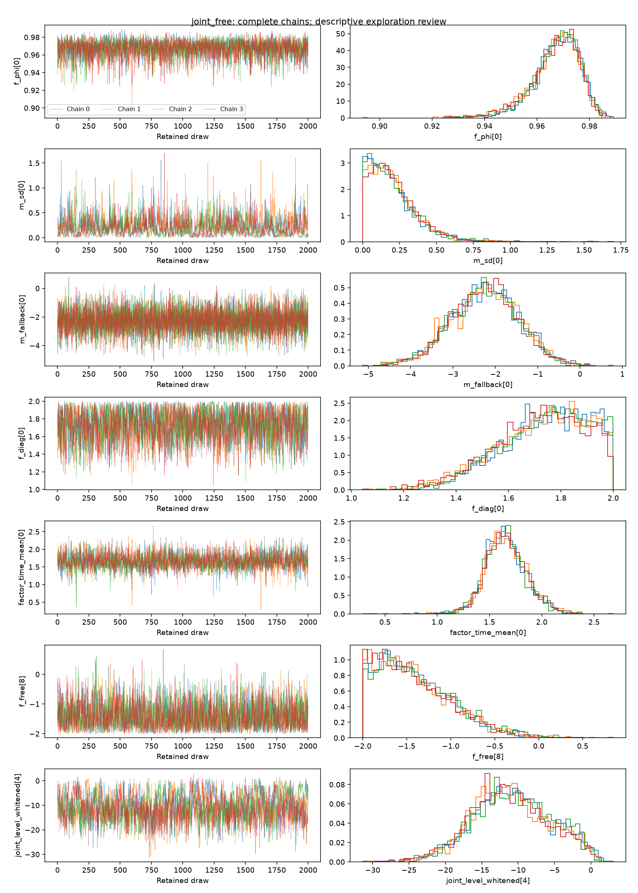
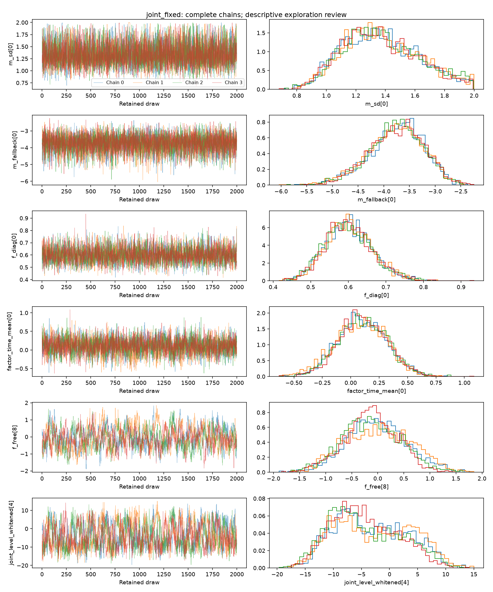

# Reauthorized Stage 7 evidence

The [report](../../STAGE7_REAUTHORIZED_REPORT.md) states the outcome and limits.
These are two fresh fits from clean commit `d67871e`, not continuations of the
previous timeouts. Both complete all four chains. The free fit passes numerical
gates; the fixed fit fails R-hat and bulk ESS. Recovery remains limited.

- [Independent diagnostic and checkpoint audit](diagnostics.json)
- [Descriptive chain summaries](exploration.json)
- [Recorded visual-review decision](review-decision.json)
- [Free-fit synthetic recovery](recovery.json)
- [Final checks](final-checks.json)

The plots include the fixed fit's flagged fallback loading and worst-R-hat
joint coordinate, selected for diagnosis after its numerical result. They do
not introduce new pass thresholds. `exploration.json` records that the automated
summary awaited visual review; `review-decision.json` records its completion.
No four-chain sample is assembled by mixing separate attempts. The full local
artifacts and checkpoints are bound by the hashes in `diagnostics.json`.
